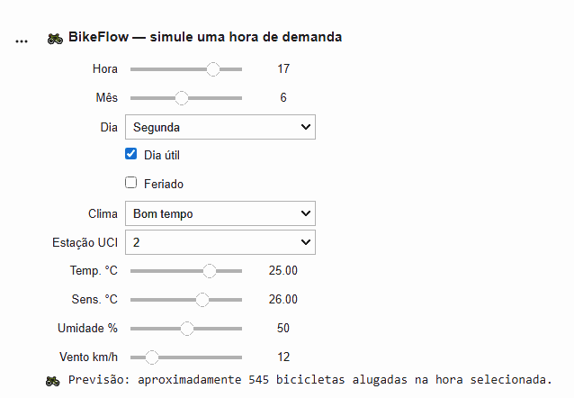

# 🚲 BikeFlow — NeuroStartup

**FMU • Inteligência Artificial e Machine Learning • Aula 08 • Atividade Prática 3**  
**Desafio escolhido:** #3 — Prever quantas bicicletas compartilhadas serão alugadas por hora.

## O problema e o cliente

Uma operadora de bicicletas compartilhadas precisa planejar quantas bicicletas devem estar disponíveis ao longo do dia. A BikeFlow usa uma rede neural **Keras** treinada com registros históricos de aluguel, horário e condições meteorológicas para estimar a **quantidade de aluguéis em uma hora**. O objetivo é apoiar o planejamento, não tomar decisões operacionais automáticas.

**Base:** [Bike Sharing — UCI Machine Learning Repository](https://archive.ics.uci.edu/dataset/275/bike+sharing+dataset). Dados reais de Washington, D.C. (2011–2012), licença CC BY 4.0. O notebook baixa `hour.csv` automaticamente e guarda em `data/hour.csv`.

## Integrantes (preencher antes da entrega)

| Nome completo | RA |
|---|---|
| Rogens Brasileiro Alcantara dos Santos | [RA A PREENCHER] |
| [NOME DO INTEGRANTE 2] | [RA 2] |
| [NOME DO INTEGRANTE 3] | [RA 3] |
| [NOME DO INTEGRANTE 4] | [RA 4] |
| [NOME DO INTEGRANTE 5, se houver] | [RA 5] |
| [NOME DO INTEGRANTE 6, se houver] | [RA 6] |

> A atividade pede **4 a 6 integrantes**. Preencha somente os integrantes reais e remova linhas não utilizadas.

## O que o projeto faz

1. **Conhece os dados:** explica o problema e produz **2 gráficos exploratórios**, com suas respectivas conclusões.
2. **Compara modelos:** regressão Ridge como baseline, **3 arquiteturas Keras**, mais uma árvore de decisão opcional (bônus). Usa Dropout, Early Stopping, curvas de aprendizado e `experimentos.csv`.
3. **Abre o cofre:** mantém o último bloco cronológico de 20% separado, avaliado somente após escolher a arquitetura por validação.
4. **Entrega produto:** salva modelo em `.keras`, transformador e escala em `.joblib`, cria função de previsão e **painel de controles no notebook**. Há também um `app.py` de terminal opcional.
5. **Documenta:** gera `MODEL_CARD.md` com finalidade, proibições de uso, origem dos dados, resultados e limitações.

**Cuidados metodológicos:** os campos `casual` e `registered` são excluídos porque sua soma é a própria resposta (`cnt`). Os dados são divididos cronologicamente (60% treino / 20% validação / 20% teste). As transformações são ajustadas somente no conjunto de treino.

## Como rodar no Google Colab (recomendado)

1. Abra [https://colab.new](https://colab.new).
2. No menu **Arquivo → Fazer upload de notebook**, escolha `BikeFlow_Atividade_Pratica_3.ipynb`.
3. Execute as células na ordem, de preferência **Ambiente de execução → Executar tudo**. O notebook baixa os dados reais de forma automática.
4. Se aparecer erro de dependência, rode a célula de instalação explicada na seção **0. Preparação**.
5. Ao terminar, confira os dois gráficos exploratórios, o gráfico de curvas, a tabela de 3 experimentos, o resultado final e o painel de previsão.
6. Salve o notebook **com as saídas visíveis**: **Arquivo → Fazer download → Fazer download de .ipynb**. No painel lateral de arquivos, baixe também `experimentos.csv`, os gráficos, a pasta `modelos/`, `RESULTADOS.md` e `MODEL_CARD.md`.
7. Faça uma **captura verdadeira do painel interativo em funcionamento** e salve com o nome `assets/tela_funcionando.png`. Insira a imagem na seção abaixo.

> No Colab, os arquivos são criados na pasta de execução (`/content`). Para uma entrega organizada, mova os arquivos gerados para dentro da pasta do projeto antes de enviar ao GitHub.

## Como rodar no VS Code

```bash
python -m venv .venv
# Windows: .venv\Scripts\activate
# macOS/Linux: source .venv/bin/activate
pip install -r requirements.txt
jupyter notebook BikeFlow_Atividade_Pratica_3.ipynb
```

Se seu ambiente não tiver TensorFlow mas tiver PyTorch, escolha o backend antes de iniciar:

```bash
# Linux/macOS
KERAS_BACKEND=torch jupyter notebook BikeFlow_Atividade_Pratica_3.ipynb
```

## Resultados e evidências

**Não foram preenchidas métricas artificiais.** Os números abaixo são calculados pelo notebook quando ele é executado com o dataset real:

- **Tabela de experimentos:** [experimentos.csv](experimentos.csv) (criada durante a execução).
- **Métricas e frase de negócio:** [RESULTADOS.md](RESULTADOS.md) (criado durante a execução).
- **Gráfico 1:** `graficos/01_demanda_por_hora.png` (gerado na execução).
- **Gráfico 2:** `graficos/02_demanda_por_clima.png` (gerado na execução).
- **Curvas de treino/validação:** `graficos/03_curvas_aprendizado.png` (gerado na execução).
- **Print da interface:** após executar, salve `assets/tela_funcionando.png` e retire a linha de comentário abaixo.

<!-- Substitua por uma captura REAL da interface funcionando:

-->

## Estrutura

```text
NeuroStartup_BikeFlow/
├── BikeFlow_Atividade_Pratica_3.ipynb  # Notebook completo, precisa ser executado
├── app.py                              # Simulador de terminal após treinamento
├── README.md                           # Explicação, equipe e instruções
├── MODEL_CARD.md                       # Modelo inicial; notebook atualiza métricas
├── RESPOSTAS_CADERNO.md                # Partes A, B e C da atividade
├── APRESENTACAO_DEMO_DAY.md            # Roteiro de apresentação
├── requirements.txt                    # Dependências
├── data/                               # Criará hour.csv real
├── graficos/                            # Gerados pelo notebook
├── modelos/                             # Salvos após treinamento
├── assets/                              # Print da interface em funcionamento
└── tests/                               # Verificação básica local
```

## Uso de IA — declaração exigida pela atividade

Foi utilizada **IA generativa (ChatGPT/OpenAI)** para auxiliar na elaboração do esqueleto do notebook, na implementação do pré-processamento, arquiteturas em Keras, documentação e explicação das etapas. **As métricas finais são calculadas pelo código a partir dos dados reais e não devem ser inventadas.** Os integrantes devem revisar, executar, entender e validar o trabalho antes da apresentação.

## Limitações e ética

A base cobre **Washington entre 2011–2012**, e não 2026 nem outras cidades. As previsões dependem de variáveis climáticas informadas e não consideram eventos extraordinários, disponibilidade por estação, manutenção, acidentes ou novas políticas de mobilidade. Não usar para punir funcionários, impor preços discriminatórios ou prometer disponibilidade sem revisão. Consulte [MODEL_CARD.md](MODEL_CARD.md).

## Fonte

Fanaee-T, H. (2013). *Bike Sharing* [dataset]. UCI Machine Learning Repository. https://doi.org/10.24432/C5W894. Licença CC BY 4.0.