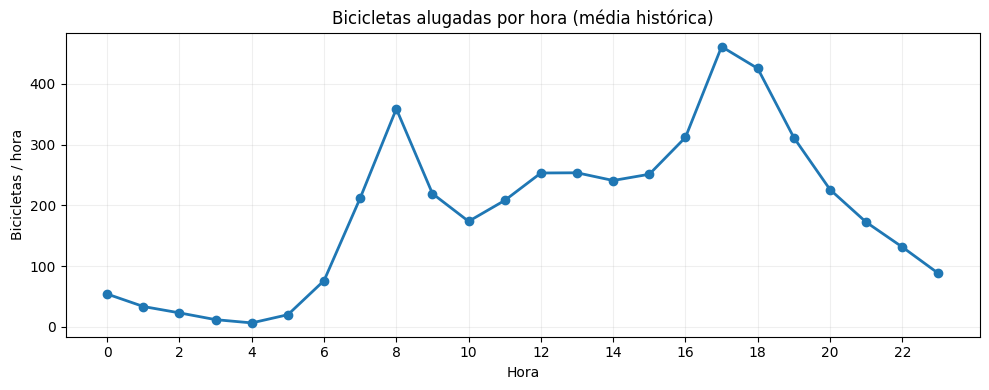
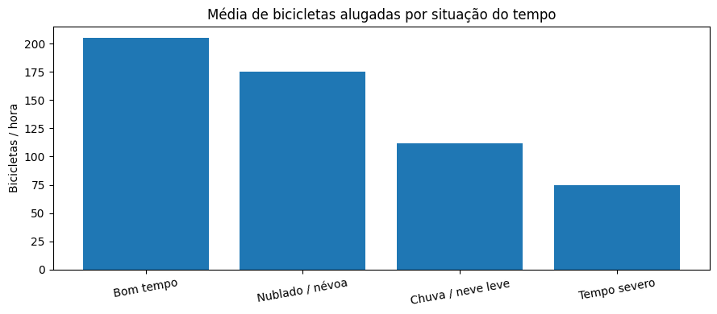
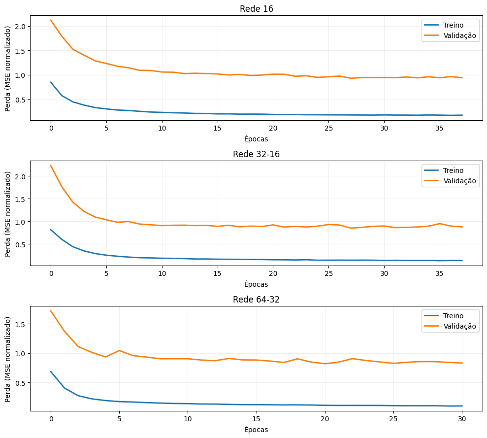

# 🚲 BikeFlow — NeuroStartup

**FMU • Inteligência Artificial e Machine Learning • Aula 08 • Atividade Prática 3**  
**Desafio escolhido:** #3 — Prever quantas bicicletas compartilhadas serão alugadas por hora.

## O problema e o cliente

Uma operadora de bicicletas compartilhadas precisa planejar quantas bicicletas devem estar disponíveis ao longo do dia. A BikeFlow usa uma rede neural **Keras** treinada com registros históricos de aluguel, horário e condições meteorológicas para estimar a **quantidade de aluguéis em uma hora**. O objetivo é apoiar o planejamento, não tomar decisões operacionais automáticas.

**Base:** [Bike Sharing — UCI Machine Learning Repository](https://archive.ics.uci.edu/dataset/275/bike+sharing+dataset). Dados reais de Washington, D.C. (2011–2012), licença CC BY 4.0. O notebook baixa `hour.csv` automaticamente e guarda em `data/hour.csv`.


| Nome completo | RA |
|---|---|
| Rogens Brasileiro Alcantara dos Santos | 2188134 |
| Arthur Weber | 2856104 |
| Matheus Correa | 2854840 |
| Calebe França | 2768672 |
| Gabriel Moreli | 2758798 |


## O que o projeto faz

1. **Conhece os dados:** explica o problema e produz **2 gráficos exploratórios**, com suas respectivas conclusões.
2. **Compara modelos:** regressão Ridge como baseline, **3 arquiteturas Keras**, mais uma árvore de decisão opcional (bônus). Usa Dropout, Early Stopping, curvas de aprendizado e `experimentos.csv`.
3. **Abre o cofre:** mantém o último bloco cronológico de 20% separado, avaliado somente após escolher a arquitetura por validação.
4. **Entrega produto:** salva modelo em `.keras`, transformador e escala em `.joblib`, cria função de previsão e **painel de controles no notebook**. Há também um `app.py` de terminal opcional.
5. **Documenta:** gera `MODEL_CARD.md` com finalidade, proibições de uso, origem dos dados, resultados e limitações.

**Cuidados metodológicos:** os campos `casual` e `registered` são excluídos porque sua soma é a própria resposta (`cnt`). Os dados são divididos cronologicamente (60% treino / 20% validação / 20% teste). As transformações são ajustadas somente no conjunto de treino.

## Como rodar no Google Colab (recomendado)

1. Abra [https://colab.new](https://colab.new).
2. No menu **Arquivo → Fazer upload de notebook**, escolha `BikeFlow_Atividade_Pratica_3.ipynb`.
3. Execute as células na ordem, de preferência **Ambiente de execução → Executar tudo**. O notebook baixa os dados reais de forma automática.
4. Se aparecer erro de dependência, rode a célula de instalação explicada na seção **0. Preparação**.
5. Ao terminar, confira os dois gráficos exploratórios, o gráfico de curvas, a tabela de 3 experimentos, o resultado final e o painel de previsão.
6. Salve o notebook **com as saídas visíveis**: **Arquivo → Fazer download → Fazer download de .ipynb**. No painel lateral de arquivos, baixe também `experimentos.csv`, os gráficos, a pasta `modelos/`, `RESULTADOS.md` e `MODEL_CARD.md`.
7. Faça uma **captura verdadeira do painel interativo em funcionamento** e salve com o nome `assets/tela_funcionando.png`. Insira a imagem na seção abaixo.

> No Colab, os arquivos são criados na pasta de execução (`/content`). Para uma entrega organizada, mova os arquivos gerados para dentro da pasta do projeto antes de enviar ao GitHub.

## Como rodar no VS Code

```bash
python -m venv .venv
# Windows: .venv\Scripts\activate
# macOS/Linux: source .venv/bin/activate
pip install -r requirements.txt
jupyter notebook BikeFlow_Atividade_Pratica_3.ipynb
```

Se seu ambiente não tiver TensorFlow mas tiver PyTorch, escolha o backend antes de iniciar:

```bash
# Linux/macOS
KERAS_BACKEND=torch jupyter notebook BikeFlow_Atividade_Pratica_3.ipynb
```

## Resultados reais e evidências (Google Colab)

O notebook foi executado sobre **17.379 registros reais** da UCI (2011–2012), sem erros nas 15 células de código. Foi mantida a divisão **cronológica** entre treino (10.427), validação (3.476) e teste (3.476). Os dados de teste não foram utilizados para escolher a arquitetura.

A rede vencedora na validação usou **64 e 32 neurônios**, com Dropout de 15% e Early Stopping.

| Modelo | MAE de validação (bicicletas/h) | MAE no teste (bicicletas/h) |
|---|---:|---:|
| Keras (64, 32) | **88,22** | **90,06** |
| Regressão Ridge | 115,53 | 115,88 |
| Árvore de decisão (bônus) | 132,01 | 134,73 |

**Resultado em linguagem de negócio:** no período futuro reservado ao teste, a rede errou em média **90,1 bicicletas/hora**, redução de **22,3%** no erro em comparação ao modelo linear (115,9). Isso é uma **avaliação histórica**, não garantia de desempenho atual.

**Conclusões dos dois gráficos exploratórios:**
- A maior demanda média histórica apareceu às **17h**, com cerca de **461,5** aluguéis/hora.
- A classe meteorológica **1 (bom tempo)** teve a maior média (204,9/h), enquanto a classe **4 (tempo severo)** teve a menor (74,3/h). Associação observacional, não prova de causalidade.

**Arquivos para conferência:**
- [Notebook executado com os resultados](BikeFlow_Atividade_Pratica_3.ipynb)
- [Três experimentos Keras](experimentos.csv)
- [Resultados e comparação](RESULTADOS.md)
- [Métricas em JSON](modelos/metricas.json)
- [Model Card com resultados reais](MODEL_CARD.md)

**Gráficos gerados pelo treinamento** (exportados dos resultados do notebook):







**Modelo salvo:** a execução gerou `modelos/bikeflow.keras`, `modelos/preprocessador.joblib` e `modelos/escala_alvo.joblib`. Esses binários estão no pacote de resultados do Colab, mas **não estão versionados neste repositório** (podem ser regenerados executando o notebook). O script `app.py` requer esses arquivos locais para funcionar.

**Print da interface:** falta adicionar a captura real do painel `ipywidgets` executado no Colab, em `assets/tela_funcionando.png`. Quando estiver disponível, remova o comentário abaixo:

<!--

-->

## Estrutura

```text
NeuroStartup_BikeFlow/
├── BikeFlow_Atividade_Pratica_3.ipynb  # Notebook executado com saídas reais
├── app.py                              # Simulador de terminal após treinamento
├── README.md                           # Explicação, equipe e instruções
├── MODEL_CARD.md                       # Model Card preenchido com métricas reais
├── RESPOSTAS_CADERNO.md                # Partes A, B e C da atividade
├── APRESENTACAO_DEMO_DAY.md            # Roteiro de apresentação
├── requirements.txt                    # Dependências
├── data/                               # Criará hour.csv real
├── graficos/                            # 3 gráficos reais publicados
├── modelos/                             # Métricas publicadas; binários no ZIP do Colab
├── assets/                              # Print da interface em funcionamento
└── tests/                               # Verificação básica local
```

## Uso de IA — declaração exigida pela atividade

Foi utilizada **IA generativa (ChatGPT/OpenAI)** para auxiliar na elaboração do esqueleto do notebook, na implementação do pré-processamento, arquiteturas em Keras, documentação e explicação das etapas. **As métricas finais são calculadas pelo código a partir dos dados reais e não devem ser inventadas.** Os integrantes devem revisar, executar, entender e validar o trabalho antes da apresentação.

## Limitações e ética

A base cobre **Washington entre 2011–2012**, e não 2026 nem outras cidades. As previsões dependem de variáveis climáticas informadas e não consideram eventos extraordinários, disponibilidade por estação, manutenção, acidentes ou novas políticas de mobilidade. Não usar para punir funcionários, impor preços discriminatórios ou prometer disponibilidade sem revisão. Consulte [MODEL_CARD.md](MODEL_CARD.md).

## Fonte

Fanaee-T, H. (2013). *Bike Sharing* [dataset]. UCI Machine Learning Repository. https://doi.org/10.24432/C5W894. Licença CC BY 4.0.
